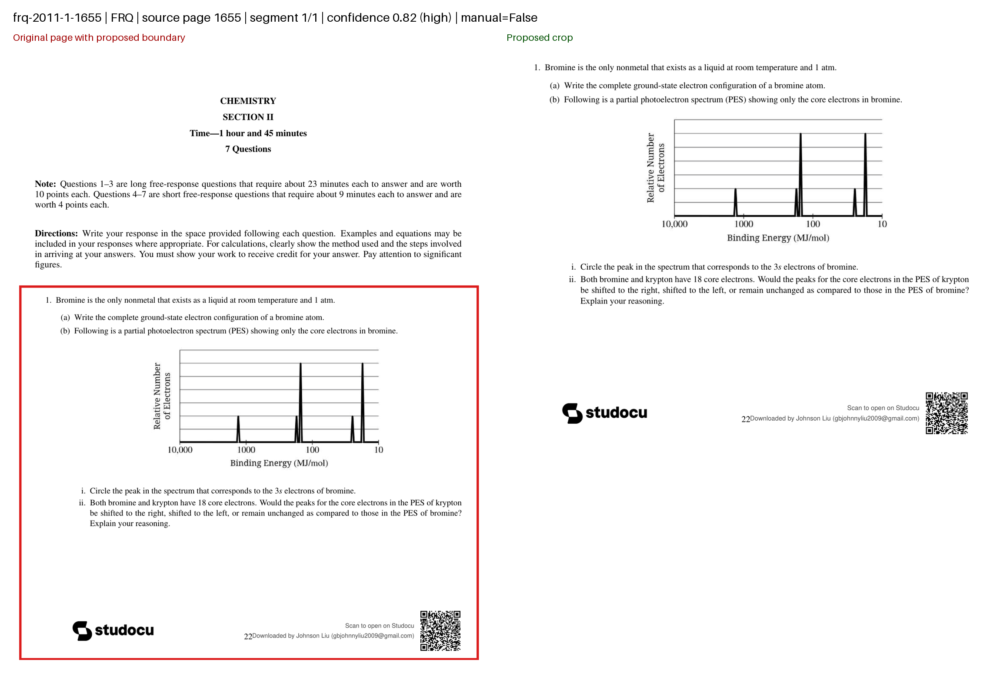

# Batch 2 — stopped after sample 6

## Frozen detector and selection

The five selected questions are samples 6–10 from the original preregistered 40-question sample. Selection lock: `batch-02-lock.json`; detector commit `acfead30f34ce9e48842c6c4b663bc358b7f1fac`; SHA-256 `d692cdf3c11eb4f83c2c5d08de48168d29385d08e2a183f8776252a56b0b3809`. The selection was committed before crop generation. No replacement questions were used.

Only the first selected question, `frq-2011-1-1655`, was rendered and visually scored. A material defect was found, so the audit stopped before visual inspection of samples 7–10. Detector proposal regions for all five were generated after the lock; the coordinates for samples 7–10 were visible in the generation output, but they remain unscored and are not audit results.

## Sample 6 result — `frq-2011-1-1655`

- Source: `public/source/bank-06.pdf`, catalog page 1655 (PDF page 155).
- Original catalog regions: `[0, 163.47, 612, 315.21]` and `[0, 315.21, 612, 737]`.
- Proposed region: `[8, 304.21, 605.65, 792]`; confidence 0.82/high; `manualReview=false`.
- **Completeness: pass.** The bromine stem, parts (a)–(b), PES graph with labels/units, and subparts (i)–(ii) are present; no required content appears clipped.
- **Cleanliness: fail.** The crop extends to the page bottom, retaining a large unused answer area and source-platform footer overlay (branding, QR code, and downloader text).
- **Readability: pass.** The PES graph, tick labels, and text are readable in the rendered crop.
- **Review routing: fail.** The high heuristic confidence and automatic status did not flag the visible footer contamination or excess response space.
- This is one contaminated crop and one false automatic approval; no crop in the scored sample was both complete and clean, and no defect was correctly blocked.
- Panel SHA-256: `382f85135527fc70ef66a67a40b6e96574b5fe05cbc7d1bbe3a8c0dd7f285b44`.

## Frozen-revision metrics (n=1 visually scored)

| Metric | Result |
| --- | ---: |
| Complete and clean question crops | 0/1 |
| Incomplete or contaminated crops | 1/1 |
| Correctly blocked manual-review cases | 0/1 |
| False automatic approvals | 1/1 |

These are interim frozen-revision results, not an estimate of corpus-wide performance. `frq-2011-1-1655` is development/debugging data from this point forward and cannot count as independent evidence for a revised detector. The remaining four selected questions are unscored.
